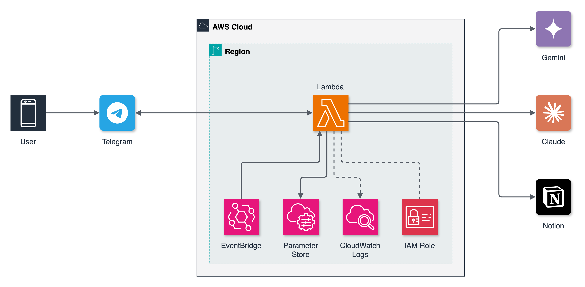

# event-scraper

**휴대폰에서 공유한 콘텐츠를 Notion 「나중에 볼 것」 함에 요약해 쌓아 주는 텔레그램 봇입니다.** 유튜브 영상·쇼츠, 아티클, 다운로드한 릴스를 내 텔레그램 봇에 보내면 AWS Lambda 하나가 Gemini와 Claude로 요약해 Notion 데이터베이스에 기록합니다. 각 행에는 한 줄 요약, 태그, 핵심, 해볼 것, 그리고 콘텐츠에 나온 도구의 공식 링크가 들어갑니다.

[English README](README.md)



- **영상과 유튜브**는 Gemini Flash가 영상을 직접 봅니다. 모델을 순서대로 씁니다(`gemini-3.8-flash` → `2.5-flash` → `3.5-flash-lite`). 무료 일일 한도가 모델별이라 하나가 다 떨어지면 다음 모델이 이어받습니다.
- **아티클과 텍스트**는 Claude Haiku 5.5가 `web_fetch`로 읽고 `web_search`로 공식 링크를 찾습니다. 링크는 실제로 읽거나 검색한 결과에 나온 URL만 남깁니다.
- **Gemini가 막히거나 할당량이 끝나면** 유튜브도 Claude가 제목과 설명을 바탕으로 대신 요약하고, 그렇게 만든 요약이라고 표시합니다.
- **Notion 웹 클리퍼로 넣은 행**(`one_liner`가 빈 행)은 하루 한 번 배치로 채웁니다.
- **모든 행의 본문 순서가 같습니다**(`## 요약 / 핵심 / 해볼 것 / 링크 / 원문`). 그래서 다른 에이전트가 나중에 함을 정리하기 쉽습니다.

각자 자기 계정에 배포해서 씁니다. 봇, Notion, API 키, AWS 계정이 모두 본인 것입니다.

## 준비물

| | 어디서 |
|---|---|
| AWS 계정 | CloudFormation, Lambda, IAM 역할, S3, SSM, EventBridge 리소스를 만들 권한 |
| 텔레그램 봇 토큰 | [@BotFather](https://t.me/BotFather)에게 `/newbot` |
| Gemini API 키 | [aistudio.google.com/apikey](https://aistudio.google.com/apikey) |
| Anthropic API 키 | [console.anthropic.com](https://console.anthropic.com) |
| Notion integration 시크릿 | [notion.so/profile/integrations](https://www.notion.so/profile/integrations)에서 internal integration 생성 |
| DB를 넣을 Notion 페이지 | 페이지를 열고 **••• > 연결(Connections) > 내 integration 추가** |

## AWS CloudShell로 설치하기 (내 컴퓨터에 설치할 것 없음)

1. AWS 콘솔에 로그인하고 리전을 고릅니다(예: 서울 `ap-northeast-2`).
2. 상단 바의 `>_` 아이콘으로 [CloudShell](https://docs.aws.amazon.com/ko_kr/cloudshell/latest/userguide/welcome.html)을 엽니다. AWS CLI, SAM CLI, Python 3, git이 미리 설치돼 있고, 콘솔 로그인으로 바로 인증됩니다.
3. 다음을 실행합니다.

   ```bash
   git clone https://github.com/Gosorasora/event-scraper.git
   cd event-scraper
   ./scripts/setup.sh
   ```

스크립트는 다음을 순서대로 처리합니다.
1. 키 4개를 묻습니다. 입력은 화면에 보이지 않고, SSM `/event-scraper/` 아래에 SecureString으로 저장됩니다.
2. webhook 시크릿을 만듭니다.
3. 봇에 메시지를 한 번 보내면 chat id를 자동으로 읽습니다.
4. 맞는 스키마로 Notion DB를 만듭니다.
5. `sam deploy`로 스택을 배포합니다.
6. 텔레그램 webhook을 등록합니다.

끝나면 봇에게 링크를 보내 보세요.

여러 번 실행해도 안전합니다. 키를 물을 때 Enter를 누르면 저장된 값을 그대로 씁니다. 키를 재발급했다면 스크립트를 다시 실행해 새 키를 붙여 넣으면 됩니다.

<details>
<summary>내 컴퓨터에서 설치하기</summary>

AWS CLI(자격 증명 설정 완료), SAM CLI, `python3`, `curl`이 필요합니다. 그다음 아래를 실행합니다.

```bash
AWS_PROFILE=<내 프로필> AWS_REGION=ap-northeast-2 ./scripts/setup.sh
```

`sam build`는 필요 없습니다. 외부 의존성이 없어서 `sam deploy`가 `src/`를 그대로 패키징합니다.
</details>

## 사용법

| 봇에게 보내는 것 | 결과 |
|---|---|
| 유튜브·쇼츠 링크 | Gemini가 영상을 보고, Claude가 공식 링크를 찾음 |
| 아티클 링크 | Claude가 읽고 공식 링크를 찾음 |
| 자바스크립트로 그려지는 페이지 링크(남의 공개 Notion 페이지, SPA) | Claude에게는 빈 껍데기만 오므로 [Jina Reader](https://jina.ai/reader/)로 렌더한 텍스트를 Claude가 읽음 |
| 링크 + 다음 줄에 메모 | 메모는 `memo` 속성에 저장 |
| 20MB 이하 영상 파일(다운로드한 릴스 등) | Gemini가 파일을 직접 봄 |
| 인스타그램 링크만 | 요약 없이 저장만 함(링크로는 내용을 읽을 수 없음). 영상 파일을 보내거나 캡션을 메모로 붙여 넣으면 분석 |

봇은 한 줄 요약과 Notion 페이지 링크로 답장합니다. 로그인이 필요한 페이지나 다른 사람의 비공개 Notion 페이지처럼 읽을 수 없는 경우에는, 추측해서 요약하지 않고 이유와 함께 **저장만 함**으로 남깁니다.

## 비용

- **AWS:** Lambda 1개, EventBridge 규칙 1개, 표준 SSM 파라미터, CloudWatch Logs. 개인 사용량은 보통 프리티어 안에 들어갑니다.
- **Gemini:** 무료 티어에 하루 요청 한도가 있습니다. [가격](https://ai.google.dev/gemini-api/docs/pricing)
- **Claude:** 웹 검색과 fetch를 포함해 쓴 만큼 냅니다. [가격](https://www.anthropic.com/pricing)

## 바꿔 쓰기

- **분류와 콘텐츠 유형:** `src/common.py`의 `CATEGORIES`, `TYPES`
- **요약 언어와 프롬프트:** `src/summarize.py`의 `PROMPT`. 기본값은 한국어 요약입니다.
- **모델:** `template.yaml`의 `GeminiModel`(쉼표로 구분, 순서대로 시도), `ClaudeModel` 파라미터. 이미 배포된 스택은 이전 파라미터 값을 유지하므로 바꿀 때는 명시적으로 넘깁니다: `sam deploy --parameter-overrides 'GeminiModel="gemini-3.8-flash,gemini-2.5-flash"'`

## 보안

- **Function URL은 공개돼 있습니다.** 대신 텔레그램 webhook 시크릿 헤더가 있고 내 chat id에서 온 요청만 처리하며, 나머지는 무시합니다.
- **키는 SSM Parameter Store에 SecureString으로 둡니다.** 코드나 Lambda 환경변수에는 넣지 않습니다. 함수의 IAM 역할은 `/event-scraper/*`만 읽을 수 있고, 콜드 스타트 때 한 번 불러옵니다.
- **보낸 콘텐츠는 외부 서비스로 갑니다.** Telegram, Google(Gemini), Anthropic(Claude), Notion이 그 내용을 받습니다. Claude가 읽지 못한 페이지는 Jina Reader에도 보내 렌더합니다.

## 삭제

```bash
sam delete --stack-name event-scraper --region "$AWS_REGION"
aws ssm delete-parameters --region "$AWS_REGION" \
  --names $(aws ssm get-parameters-by-path --path /event-scraper --region "$AWS_REGION" --query 'Parameters[].Name' --output text)
```

## 구성

```
src/            Lambda 코드 (app.py 진입점, summarize.py 모델 호출, notion.py, telegram.py, common.py)
scripts/        setup.sh, create-notion-db.py, put-params.sh, set-webhook.sh
template.yaml   SAM 템플릿
test_app.py     python3 test_app.py (네트워크 없음)
SPEC.md, DECISIONS.md   설계와 기각한 대안 기록
```

## 라이선스

[MIT](LICENSE)
